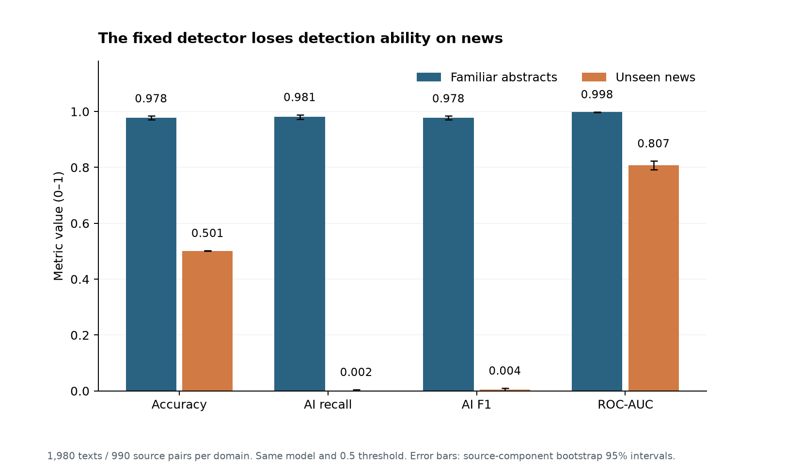

# Can AI Detectors Actually Detect AI?

Research reproduction and generalization study. **Status: Phase 3 complete — fixed-detector domain transfer and error analysis.** Coefficient interpretation and final portfolio packaging remain.

The question is whether a detector's performance survives a change in writing domain. We trained TF-IDF + logistic regression on scientific abstracts, then tested it on unfamiliar news with the same model, generator, prompt and decision threshold.

This is a **methodological reproduction and extension** of the cross-dataset design in [Xia et al. (EACL 2026)](https://aclanthology.org/2026.eacl-long.307/), using their released Mistral zero-shot texts. The detector and split assignments differ from the paper; its neural performance scores are not direct comparison targets.

**Accuracy fell from 97.78% on abstracts to 50.10% on news.** On news, the detector identified only **2 of 990 AI texts** and missed **988**; all 990 human texts were classified correctly. It predicted almost everything as human. The news-minus-abstracts accuracy change was **-47.68 percentage points**, with an independent source-component bootstrap 95% interval of **-48.33 to -46.92 points**.

| Final-test metric | Familiar abstracts | Unseen news |
|---|---:|---:|
| Accuracy | 97.78% | 50.10% |
| AI recall | 98.08% | 0.20% |
| AI F1 | 0.9778 | 0.0040 |
| Human false-positive rate | 2.53% | 0 observed |
| AI false-negative rate | 1.92% | 99.80% |
| ROC-AUC | 0.9983 | 0.8073 |

Both tests contain 1,980 texts from 990 balanced human/AI source pairs. This is a failure of this lexical detector's fixed-threshold transfer in the approved experiment, not a finding about every AI detector. ROC-AUC still shows some score separation on news, while the unchanged 0.5 threshold misses almost all AI texts. No target-domain calibration was attempted.

The [generalization report](report/generalization_report.md) includes full metrics, uncertainty, length-bin errors and three identified examples inspected with AI assistance. Zero observed human news errors does not prove zero population risk: the separately labeled exact binomial 95% interval is 0%–0.372%, conditional on independent sampled human sources. News precision of 1.0 rests on only two predicted-AI texts and is not evidence of reliable detection. The [baseline report](report/baseline_report.md) preserves the familiar-domain evaluation and original-paper comparison. Protocols were recorded before fitting and news scoring; the exact interval addition after outcomes is explicitly documented.

Phase 1 retained 12,000 texts from 6,000 human/AI source pairs, with balanced classes in each domain. Labels and pairing passed consistency checks. No exact duplicates or qualifying near duplicates were found under the specified 0.80 word-5-gram Jaccard rule. This does not rule out paraphrases, shared topics or model pretraining overlap.

| Split | Domain | Source pairs | Texts |
|---|---|---:|---:|
| Training | Abstracts | 1,500 | 3,000 |
| Validation | Abstracts | 510 | 1,020 |
| Familiar test | Abstracts | 990 | 1,980 |
| Shifted test | News | 990 | 1,980 |
| Unused | News | 2,010 | 4,020 |

Human passages are longer at the median in both domains, and news is substantially longer than abstracts. Error rates are reported in the length bins fixed in Phase 0, with denominators and small-sample flags. Domain transfer does not isolate a causal effect of topic, length or style.

Read the [data overview](report/data_overview.md) for preparation checks and limitations, [feasibility report](research/paper_feasibility.md) for the original selection, and [Phase 0 evidence](research/feasibility_evidence.json) for the download inspection. [Setup and reproduction instructions](INSTRUCTIONS.md) explain how to regenerate Phases 1–3. Start with Python 3.12 and `requirements.txt`; run preparation, EDA, baseline training/reporting, then generalization evaluation, error analysis and reporting in that order.

The working clone is in `E:\Personal Projects\AI Detectors`. Code is covered by this repository's MIT license; the upstream data card declares Apache-2.0. Raw and processed text remain local and are ignored by Git. Source URLs, license distinctions and acquisition instructions are in [data/README.md](data/README.md).

Repository contents: `src/` contains preparation, EDA, training, evaluation and reporting; `tests/` contains leakage, metric and statistical-check regression tests; `outputs/` contains text-free tables, predictions and figures; `report/` contains generated reports; `research/` contains the Phase 0 decision record, protocols and AI-assisted example descriptions. The prepared text-bearing CSV is local under `data/processed/`, and the saved pipeline is local under `models/`. Full error-example text remains in ignored scratch files.

AI assistance was used for research retrieval, coding, debugging, source-table verification, reading the selected error examples and documentation. Tables and charts come from executed code and the pinned public dataset. No independent research validation or manual review of every passage is claimed. Next phase: coefficient interpretation and careful explanation of observed associations.
