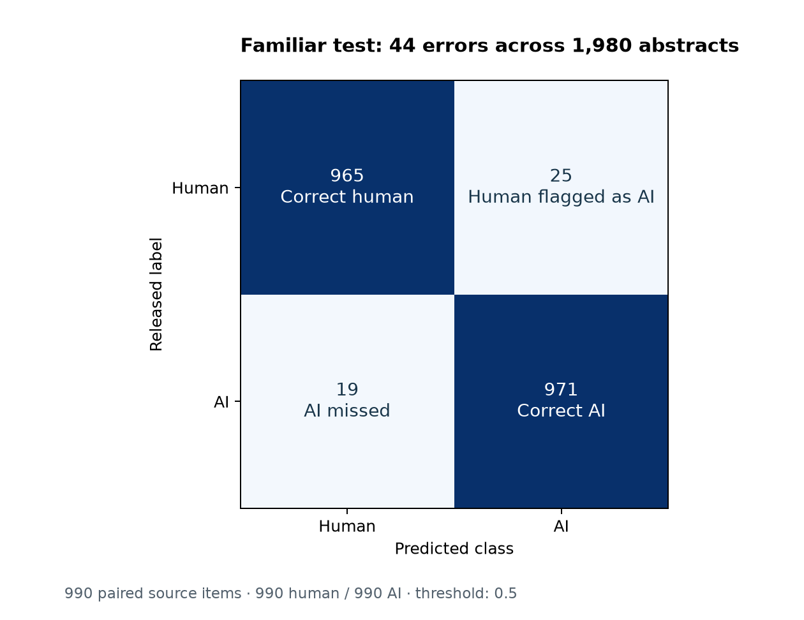

# Baseline model: familiar-distribution evaluation

Phase 2 completed October 12, 2026. This is an inexpensive lexical baseline within the approved methodological reproduction. It does not reproduce the original paper's neural classifier or original split assignments. Cross-domain generalization has not yet been measured.

## Main result

On **1,980 held-out abstracts** from **990 source pairs**, accuracy is **97.78%** and AI F1 is **0.9778**. The detector incorrectly flags **25 of 990 human abstracts** as AI (2.53%) and misses **19 of 990 AI abstracts** (1.92%). Both classes are equally represented.

The source-pair bootstrap 95% accuracy interval is 97.07%–98.43%; the human false-positive interval is 1.62%–3.54%. Strong familiar-domain performance does not establish reliability on news, other generators or real-world human writing.

## Fixed model and evaluation design

The [protocol](../research/phase2_protocol.md) was committed before model fitting. Its commit precedes the baseline implementation and any generated detector outcomes. The model fits **3,000 abstract texts**, including 1,500 human and 1,500 AI texts, from 1,500 paired sources. Abstract validation contains 1,020 texts from 510 pairs. Familiar test contains 1,980 texts from 990 pairs. Source items and linked duplicate components remain disjoint across splits.

A scikit-learn Pipeline fits TF-IDF only on training text, then logistic regression on the resulting sparse matrix. Representation: word unigrams/bigrams, `min_df=2`, at most 30,000 features, lowercasing, no stop-word list, smoothed IDF, raw term frequencies and L2 document normalization. The default token rule selects word sequences of at least two characters; it does not explicitly model capitalization or punctuation. There is no truncation, added length feature, released linguistic feature or provenance feature.

Logistic regression uses `C=1`, L2 regularization (`l1_ratio=0`), `solver=lbfgs`, `max_iter=1000`, `tol=1e-4`, an intercept, no class weighting and seed 42. AI is positive (`1`). Probabilities at or above **0.5** predict AI. This threshold was not tuned to the final test or to a desired false-positive rate. There was no hyperparameter search, no validation refit and no change to the prespecified configuration. Validation was evaluated before final test evaluation. No news text was transformed for scoring in Phase 2.

The fitted vocabulary contains 30,000 features. The training matrix has 561,811 nonzero values. The optimizer converged in 19 iterations without a convergence warning. The recorded fit time was 1.31 seconds and total fitting/evaluation/output time was 8.06 seconds on the local Windows CPU, with numeric threads limited to one. These are observations from this run, not universal runtime guarantees.

## Metrics and uncertainty

| Metric | Validation | Familiar final test | Test 95% bootstrap interval |
| --- | --- | --- | --- |
| Accuracy | 0.984314 | 0.977778 | 0.970707–0.984343 |
| AI precision | 0.986220 | 0.974900 | 0.965139–0.983887 |
| AI recall | 0.982353 | 0.980808 | 0.971717–0.988889 |
| AI F1 | 0.984283 | 0.977845 | 0.970824–0.984351 |
| Human false-positive rate | 0.013725 | 0.025253 | 0.016162–0.035354 |
| AI false-negative rate | 0.017647 | 0.019192 | 0.011111–0.028283 |
| ROC-AUC | 0.998493 | 0.998270 | 0.997220–0.999065 |

Precision, recall and F1 use AI as positive. Human FPR is `FP / (FP + TN)`; AI FNR is `FN / (FN + TP)`. ROC-AUC uses continuous AI scores, not thresholded labels. Validation is a development check, not an additional final test. The difference between validation and test scores is descriptive and was not used to choose a different model.

Each interval uses 1,000 percentile bootstrap draws that resample whole leakage components, retaining both texts of every human/AI source pair. Seeds are 42 for validation and 43 for the familiar test. There are no linked multi-source components in this dataset subset, so the resampling unit is currently the source pair. The intervals condition on this fitted model and sampled abstract sources; they do not quantify uncertainty from retraining, generator choice or domain transfer. They are not hypothesis tests.

## Original-paper comparison

[Xia et al., EACL 2026](https://aclanthology.org/2026.eacl-long.307.pdf), Table 7, printed page 6542 (PDF page 19), reports the corresponding Mistral zero-shot abstract in-domain neural scores below. The row and column were checked against the rendered official table before training. No original neural detector was trained here.

| Experiment | Original paper | Our result | Comparable? | Explanation |
| --- | --- | --- | --- | --- |
| TF-IDF + logistic regression; Mistral zero-shot abstracts | Not reported | Accuracy 0.977778 | No matched original baseline | New lexical baseline; newly grouped split; different tokenization and detector. |
| DeBERTa-V3-small; Mistral zero-shot abstracts | Accuracy 0.9860 (Table 7) | Not run | No | Original neural architecture and split not reproduced; context only. |
| XLM-RoBERTa-base; Mistral zero-shot abstracts | Accuracy 0.9835 (Table 7) | Not run | No | Original neural architecture and split not reproduced; context only. |

These are context, not a matched competition. Architecture, original split membership, sequence handling and implementation differ. We cannot attribute score differences to detector quality alone, claim neural-score reproduction or infer statistical agreement with the paper. Our Phase 3 experiment will adapt its cross-dataset evaluation logic using this already fitted lexical detector.

## Reproducibility and validation

After Phase 1 preparation, run `python src/train_baseline.py`, then `python src/report_baseline.py`. The pipeline is saved locally at `models/baseline.joblib`; it is ignored by Git and can be regenerated. `outputs/tables/baseline_predictions.csv` contains row IDs, source groups, released labels and scores/predictions without text. `baseline_metrics.csv` stores full-precision metrics and confidence intervals. `baseline_run.json` records input/output checksums, parameters, versions, convergence, the pre-run code commit and timings. The stored model produces identical validation probabilities after reloading.

The input corpus and manifest were checked against frozen Phase 1 checksums. Executed regression tests cover hand-calculated rates on an imbalanced example, threshold ties, no-positive predictions, intact-pair bootstrap sampling and unchanged vocabulary when transforming held-out words, in addition to the three preparation tests. The report script separately recounts confusion cells and recalculates metrics using saved predictions. A repeated run of the same fixed configuration produced byte-identical predictions and metric files; serialized model bytes differed, so the current saved model is identified by the checksum in the run record. These are internal code/output checks, not independent research validation or human authorship review.

## Limits and next phase

The familiar test consists of Mistral zero-shot outputs and released human abstracts. Class balance is artificial; precision would change with different prevalence. Labels inherit the release's provenance. Text-length differences and class-specific collection/cleaning artifacts remain possible shortcuts. The score is a model output, not a verified probability of authorship or evidence against an individual writer. No claim about native language, authorship subgroups or current commercial detectors is supported by these fields.

Phase 3 will apply this saved model and the same threshold to the frozen news test, compare conditions with appropriate component-bootstrap uncertainty, and analyze actual errors. The central generalization question remains unanswered at the end of Phase 2.

AI assistance was used for implementation, testing, source-table verification and drafting. Results are generated by the retained code and pinned dataset. The project owner has not been represented as manually reviewing every retained prediction, and no independent replication is claimed.
