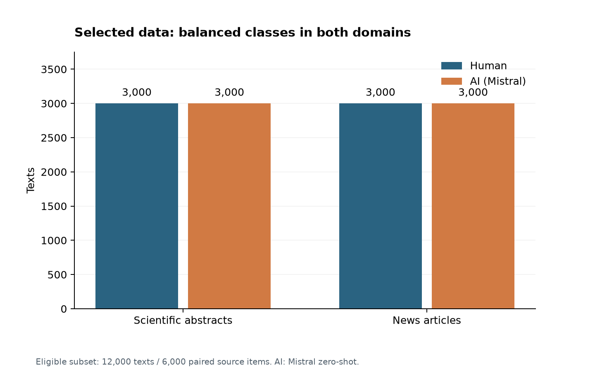
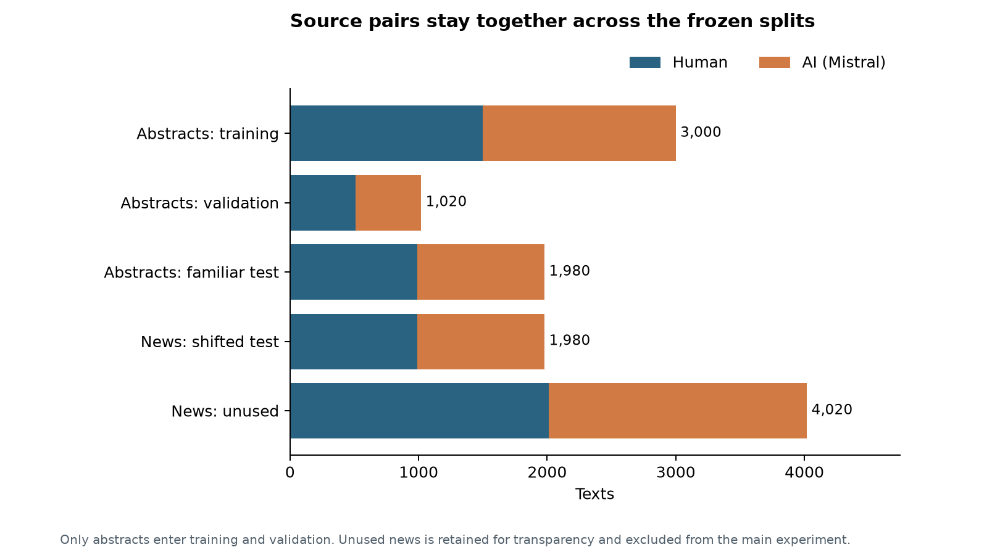
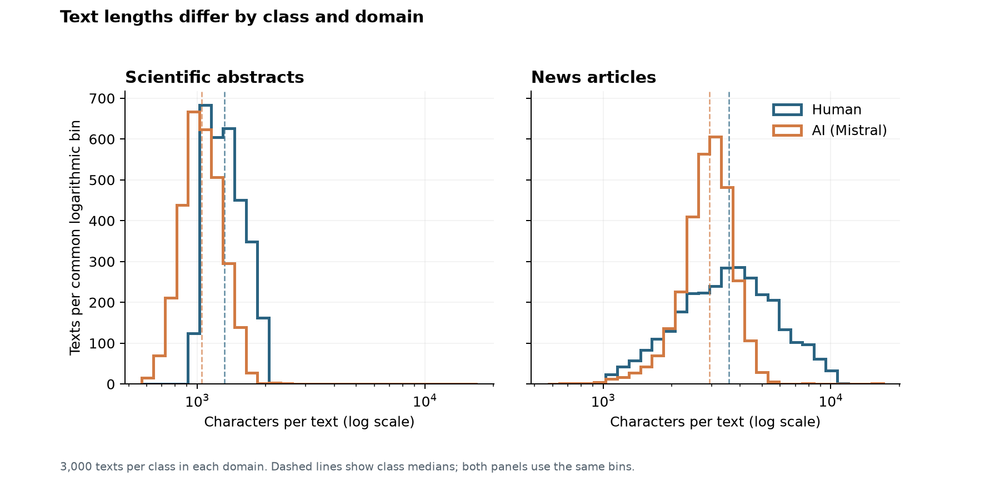

# Dataset overview and split design

Phase 1 completed October 12, 2026. The owner approved the Phase 0 paper, dataset and scope by requesting Phase 1. This report records preparation and descriptive analysis; model performance is documented separately in the [Phase 2 baseline report](baseline_report.md).

## Data and provenance

This methodological reproduction uses the public release accompanying [Xia et al. (EACL 2026)](https://aclanthology.org/2026.eacl-long.307/). The input is [the pinned main CSV](https://huggingface.co/datasets/yuxixia/AI-detector-generalization-benchmark/blob/a8bcd10fbe1f522fe47fd56f4fc75a54f36a276c/data/linguistic_analysis.csv), revision `a8bcd10fbe1f522fe47fd56f4fc75a54f36a276c`. Its dataset card declares Apache-2.0; the separate paper repository declares MIT. The release includes preprocessed human and generated texts, not original source-document metadata or split membership. No text is committed in this project.

The full input checksum was verified: `3983ed4e82550f8ab3bdfbbb37a60b89389ae250e36830ef6919e5b297550afc`. It contains 431,431 rows. The approved filter retains human texts and `model=mistral, prompt_style=zero_shot_baseline` texts in `abstracts` and `news`: **12,000 texts**, **6,000 paired source items**. AI is positive (`1`), human is `0`. The model name is release metadata mapped by the authors to Mistral-Large-Instruct-2411; it was not independently reconstructed from text.

| domain | model | label | texts |
| --- | --- | --- | --- |
| abstracts | human | 0 | 3000 |
| abstracts | mistral | 1 | 3000 |
| news | human | 0 | 3000 |
| news | mistral | 1 | 3000 |

## Preparation and integrity checks

Only six released columns are read: text, label, generator, prompt style, domain/source and item ID. The unnamed export index and precomputed feature columns are not detector inputs. Required fields were checked for blanks and common missing-value sentinels; labels were checked against generator identity; human prompt metadata was checked; every source item was checked for exactly one human and one AI row.

Text processing only normalizes line endings and strips boundary whitespace; 13 rows changed. Raw punctuation, capitalization and internal whitespace remain available to the future detector. No stop-word removal or linguistic cleanup was applied. There were no invalid rows or exact duplicates requiring removal.

| check | count |
| --- | --- |
| missing_or_sentinel_text | 0 |
| missing_or_sentinel_label | 0 |
| missing_or_sentinel_model | 0 |
| missing_or_sentinel_prompt_style | 0 |
| missing_or_sentinel_source | 0 |
| missing_or_sentinel_item_id | 0 |
| exact_excess | 0 |
| whitespace_normalized_excess | 0 |
| invalid_labels | 0 |
| unpaired_source_items | 0 |
| near_duplicate_pairs | 0 |
| cross_source_near_duplicate_pairs | 0 |
| source_group_split_overlap | 0 |
| component_split_overlap | 0 |

Near duplication was evaluated across all 12,000 texts, not just within an already chosen split. The audit casefolds words and builds sets of word 5-grams. A pair is linked if Jaccard similarity is at least 0.80. The lossless size/prefix filter ruled out every pair at this threshold; no exact Jaccard candidate comparison was needed. This is lexical duplicate detection, not a semantic paraphrase detector. Identical sets qualify; repeated shingle frequency is ignored.

The audit found 0 qualifying text pairs, including 0 pairs connecting different source items. All texts sharing `(domain, item_id)` are grouped. Qualifying near-duplicate links merge source groups transitively. The resulting 6,000 components remain intact during split assignment. Any component spanning both domains would be excluded from the main experiment; 0 such components were found. Pair IDs and similarity values, without text, are in `outputs/tables/near_duplicate_pairs.csv`.

## Frozen splits

Seed: **42**. Source groups are sorted before deterministic shuffling. Abstract components are allocated toward 50% training, 17% validation and 33% familiar test by source-item weight; a component is never divided to satisfy an exact percentage. A separate shuffle of news components selects a similarly sized shifted test. All remaining news texts are explicitly marked unused.

| domain | split | texts | source_items | components |
| --- | --- | --- | --- | --- |
| abstracts | test_familiar | 1980 | 990 | 990 |
| abstracts | train | 3000 | 1500 | 1500 |
| abstracts | validation | 1020 | 510 | 510 |
| news | test_shifted | 1980 | 990 | 990 |
| news | unused_news | 4020 | 2010 | 2010 |

There are 7,980 texts in the main experiment's active splits. News is absent from training and validation. The stored manifest freezes every selected row's source group, linked component and split. No group or qualifying duplicate component crosses split boundaries. Familiar and shifted test sets contain distinct sources; their performance difference will not be treated as a paired prediction comparison. Bootstrap sampling in later phases should use the linked component if it joins multiple source items.

These are newly constructed project splits, not the original paper's assignments. Whole-subset duplicate auditing and descriptive EDA occurred before model fitting and are disclosed. The vocabulary, TF-IDF weights, model parameters and any learned preprocessing must subsequently be fitted on abstract training data only. Validation may guide convergence or allowed settings; neither final test may guide selection. No news data may guide vocabulary or thresholds.

## Text lengths and potential shortcuts

Character counts use the retained Unicode strings. Word counts use `\w+` token matches and are a descriptive convention, not the future detector's tokenizer.

| domain | model | count | min | median | mean | max |
| --- | --- | --- | --- | --- | --- | --- |
| abstracts | human | 3000 | 1001 | 1317.0 | 1357.3 | 2289 |
| abstracts | mistral | 3000 | 571 | 1044.5 | 1071.9 | 2542 |
| news | human | 3000 | 944 | 3570.5 | 3928.4 | 10865 |
| news | mistral | 3000 | 645 | 2929.0 | 2954.6 | 16834 |

Human text is longer at the median in both domains. News is substantially longer than abstracts. Therefore domain transfer changes topic, writing context, text length and the released generation/cleaning conditions together. An apparent performance difference cannot isolate one cause. Later error analysis will report class-specific denominators in the approved fixed character bins, and coefficient inspection will describe predictive associations without causal claims.

## Remaining limitations

- Word-shingle similarity below 0.80, paraphrases and shared facts/topics can remain undetected. The rule does not prove the absence of all leakage.
- Author identities, original source URLs, publication identifiers and model pretraining records are not present in the selected fields. Author overlap and generator pretraining contamination cannot be eliminated from this release.
- Human and AI passages share source items but may differ in length, task and class-specific cleaning. The detector may learn collection artifacts.
- Labels and generator identities come from the research release. No independent human authorship verification occurred.
- This scope covers one generator, one prompt and one direction of domain transfer. It does not assess current commercial AI detectors or all AI writing.

## Reproduction and checkpoint

From the repository root, install `requirements.txt`, run `python src/prepare_data.py`, then `python src/eda.py`. The first command downloads the pinned source if absent and verifies its checksum. An existing source file can be passed with `--input`. Run `python -m unittest discover -s tests -v` for the candidate-filter and group-splitting regression checks. See `INSTRUCTIONS.md` for setup and validation commands.

Executed validation includes input checksum verification, label/pair checks, exact and near-duplicate audits and group-disjoint split assertions. Regression tests compare candidate filtering against exhaustive pair comparison on synthetic sets, check transitive source linking and check cross-domain exclusion. These are code checks, not an independent research replication. Generated figures were visually inspected before committing the Phase 1 checkpoint; the actual Git status and commit hash are reported in chat.

AI assistance was used for implementation, debugging, research interpretation and documentation. These tables and figures are generated from the documented input by the retained scripts. No claim is made that the project owner manually reviewed all texts or independently validated the analyses.

At the Phase 1 checkpoint, the next step was training the approved TF-IDF + logistic regression baseline. Its completed familiar-test evaluation is documented in the linked Phase 2 report. This report retains the preparation checks and descriptive analysis.
