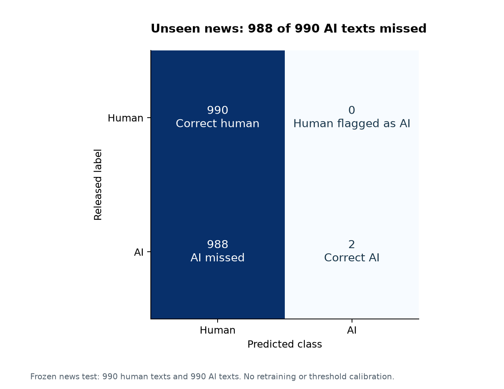
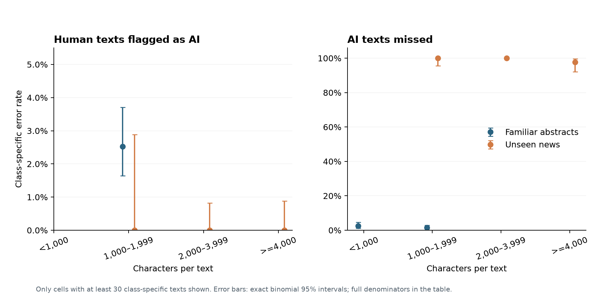

# Domain transfer and error analysis

Phase 3 completed October 13, 2026. The frozen Phase 2 detector was applied to the frozen news test without refitting, expanding its vocabulary or changing the 0.5 decision threshold.

## Main finding

**Accuracy fell from 97.78% on familiar abstracts to 50.10% on unseen news**, a change of -47.68 percentage points. The independent source-component bootstrap 95% interval for this change is -48.33 to -46.92 percentage points. Each test has 1,980 texts, 990 human and 990 AI, from 990 matched source pairs.

The detector identified only **2 of 990 AI news texts** and missed **988** (99.80% FNR). It labeled all 990 human news texts correctly. It predicted human for 1,978 of 1,980 texts, making accuracy close to the 50% always-human reference on this balanced sample. That reference is a mathematical class-balance comparison, not another fitted model.

This is evidence of poor fixed-threshold transfer for this lexical detector in this experiment. It is not evidence that every AI detector fails or that writing domain alone caused the change. The [Phase 4 interpretation report](interpretation_report.md) documents the literal prompt/task and human-source differences bundled into this comparison, alongside coefficient and score analysis.

| Metric | Abstracts | News | Change (news minus abstracts) |
| --- | --- | --- | --- |
| Accuracy | 0.977778 | 0.501010 | -0.476768 |
| AI precision | 0.974900 | 1.000000 | +0.025100 |
| AI recall | 0.980808 | 0.002020 | -0.978788 |
| AI F1 | 0.977845 | 0.004032 | -0.973813 |
| Human FPR | 0.025253 | 0.000000 | -0.025253 |
| AI FNR | 0.019192 | 0.997980 | +0.978788 |
| ROC-AUC | 0.998270 | 0.807293 | -0.190976 |

ROC-AUC remains 0.8073, while recall at the fixed threshold is 0.20%. Thus score ranking and thresholded detection tell different stories. The experiment has not tested whether target-domain calibration would improve performance. Changing the threshold after seeing this test would invalidate the prespecified comparison.

News precision is 1.00, based on only 2 predicted-AI texts. It should not be read as reliable detection: almost all AI texts were missed. The raw precision bootstrap interval is uninformative here because resamples without predicted positives use the previously documented zero-precision convention. Full metric and difference intervals are retained in `generalization_metrics.csv` and `generalization_changes.csv`; no significance claim is made.

## Design and uncertainty

The [Phase 3 protocol](../research/phase3_protocol.md) was committed before news scoring. The run record's protocol checksum captures that pre-outcome version at its recorded code-base commit; the current protocol additionally contains the explicitly dated reporting amendment below. The saved model was checked against Phase 2's SHA-256 and remained unchanged afterward. Phase 1 corpus/manifest checksums and Phase 2 output checksums were verified. The loaded model reproduced the saved familiar-test scores within numerical tolerance. Only `test_shifted` news was newly scored; unused news, training and validation are absent from Phase 3 summaries. No model selection, recalibration or new feature fitting occurred.

News intervals use 1,000 intact-component bootstrap draws (seed 44). Difference intervals independently resample each domain's components (seed 45); these are disjoint source samples, not paired predictions. Familiar intervals are the existing Phase 2 intervals. They condition on the fitted detector and source samples, not the universe of domains or retraining outcomes.

Zero news false positives produce a degenerate bootstrap FPR interval of [0,0]. A separately labeled exact binomial interval was added after this outcome was observed, with the reason recorded in the protocol amendment. The two-sided 95% interval for news human FPR is **0.000%–0.372%**, assuming independent sampled human source items. This avoids treating zero observed errors as proof of zero population risk. Exact class-specific intervals are in `domain_error_rates.csv` and the length table. They use [SciPy's Clopper–Pearson implementation](https://docs.scipy.org/doc/scipy/reference/generated/scipy.stats._result_classes.BinomTestResult.proportion_ci.html) and do not replace the primary component-bootstrap accuracy-change analysis.

## Errors by text length

These bins were fixed in Phase 0. All rates use the relevant class as denominator: human texts for false positives, AI texts for false negatives. Zero-sample bins are undefined; fewer than 30 texts is flagged as a small sample. The chart omits small cells while the table preserves them.

| Domain | Error type | Characters | Errors / class texts | Rate | Sample note |
| --- | --- | --- | --- | --- | --- |
| abstracts | false_positive | <1,000 | 0/0 | Undefined | No texts |
| abstracts | false_positive | 1,000–1,999 | 25/989 | 2.53% |  |
| abstracts | false_positive | 2,000–3,999 | 0/1 | 0.00% | Small (<30) |
| abstracts | false_positive | >=4,000 | 0/0 | Undefined | No texts |
| abstracts | false_negative | <1,000 | 10/399 | 2.51% |  |
| abstracts | false_negative | 1,000–1,999 | 9/589 | 1.53% |  |
| abstracts | false_negative | 2,000–3,999 | 0/2 | 0.00% | Small (<30) |
| abstracts | false_negative | >=4,000 | 0/0 | Undefined | No texts |
| news | false_positive | <1,000 | 0/1 | 0.00% | Small (<30) |
| news | false_positive | 1,000–1,999 | 0/126 | 0.00% |  |
| news | false_positive | 2,000–3,999 | 0/448 | 0.00% |  |
| news | false_positive | >=4,000 | 0/415 | 0.00% |  |
| news | false_negative | <1,000 | 1/1 | 100.00% | Small (<30) |
| news | false_negative | 1,000–1,999 | 80/80 | 100.00% |  |
| news | false_negative | 2,000–3,999 | 821/821 | 100.00% |  |
| news | false_negative | >=4,000 | 86/88 | 97.73% |  |

The observed news misses occur across the supported length bins. The two detected AI news texts are in the longest bin; this is too little evidence to establish that length improves detection. Abstract errors and news errors cannot isolate a causal length effect: the domains have different content, generation conditions and class-conditional length distributions. No author, native-language or demographic fields support subgroup claims.

## Identified examples

The deterministic rule selected the highest-scoring false-positive human and lowest-scoring false-negative AI text in each domain, where such an error existed. **Three complete texts were inspected with AI assistance**; there was no news false positive to select. Full text stays local in `work/phase3/error_examples.json`; the following IDs map to the pinned corpus. Scientific claims, events and attributed quotations in these passages were not independently verified.

| Row ID | Error | AI score | Characters | AI-assisted description |
| --- | --- | --- | --- | --- |
| abstracts:2904:human | false_positive | 0.817765 | 1316 | Human-labeled computational-tool abstract about vibrational spectroscopy, with simulation benchmarks and future software-development plans. |
| abstracts:1642:mistral | false_negative | 0.320010 | 862 | AI-labeled astronomy abstract presenting a dwarf-galaxy candidate with numerical photometry and spectroscopy measurements. The underlying scientific claims were not verified. |
| news:5627:mistral | false_negative | 0.006064 | 3250 | AI-labeled news-style story about an unusual photograph, with attributed quotations and speculation about an apparent ghost. The depicted events and attributions were not verified. |

These are intentionally extreme errors, not a representative sample. Their descriptive content does not establish what features caused classification. Coefficient interpretation belongs to Phase 4. No manual project-owner review or independent validation is claimed.

## Limits, reproduction and next phase

This adapts Xia et al.'s cross-dataset design to one TF-IDF/logistic detector, one Mistral generator, one zero-shot prompt style and a newly grouped split. Abstracts are generated from category/title metadata; news is generated from article highlights. Literal prompts, generation tasks and human source corpora differ, so this study does not isolate their separate effects. Original neural scores are not matched benchmarks. Author identities, original source URLs and model pretraining records remain unavailable. Lexical near-duplicate checks cannot eliminate paraphrases or all source overlap. Released cleaning and length differences can provide shortcuts, and equal class prevalence is artificial.

After Phases 1 and 2, run `python src/evaluate_generalization.py`, `python src/analyze_errors.py`, then `python src/report_generalization.py`. Retain the saved Phase 2 pipeline: its checksum is verified. The evaluation script never calls fit. Published outputs contain identifiers, scores, counts, summaries and figures, not text. The report verifies saved metric counts and length-bin totals against the predictions. Eleven regression tests cover the original checks plus independent-change sign, component exclusion, length-bin boundaries/empty cells, deterministic error selection and the exact zero-error upper bound. These are internal checks, not independent research replication.

The generalization question now has a measured answer for the approved experiment: strong familiar-domain fixed-threshold performance did not survive this distribution change, while meaningful ranking ability remained. Coefficient and score interpretation are documented in the linked Phase 4 report. The overall portfolio project is not yet complete.
