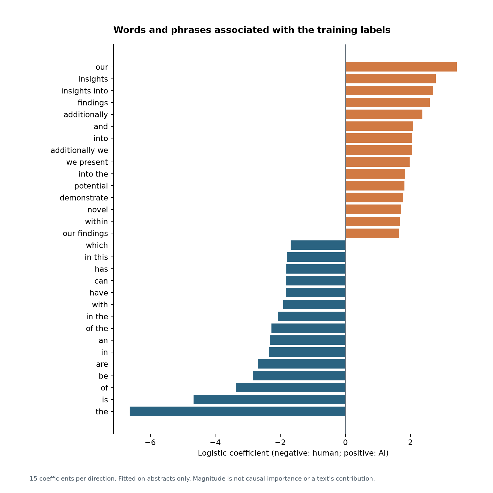
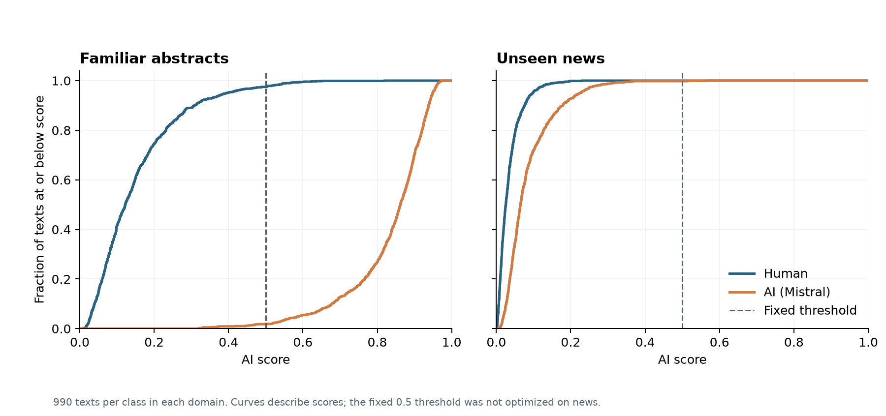

# Coefficients, score shift and limits of explanation

Phase 4 completed October 13, 2026. This analysis interprets the same frozen TF-IDF/logistic detector evaluated in Phases 2 and 3. There is no new classifier, SHAP analysis, threshold optimization or target-domain refit.

## What the experiment establishes

The detector's fixed-threshold accuracy fell from 97.78% on abstracts to 50.10% on news, with news AI recall of 0.20%. News ROC-AUC remained 0.8073: the model retained meaningful ranking ability, although it missed almost every AI news text at the unchanged 0.5 threshold. The correct finding is a severe **fixed-threshold transfer failure**, accompanied by reduced ranking performance, rather than a complete loss of class discrimination.

The [Phase 4 plan](../research/phase4_plan.md) was recorded after those results were known. Its feature-selection and accounting rules guide this descriptive analysis; it is not a preregistration of the earlier experimental finding.

## Learned lexical associations

The largest positive coefficients include `our`, `insights`, `insights into`, `findings`, `additionally` and `we present`. Large negative coefficients include `the`, `is`, `of`, `be` and `are`. These include common function words and abstract-style phrases, not universal AI fingerprints. Positive weights move the fitted score toward AI; negative weights move it toward human, conditional on the other represented features.

| Training association | Term | Coefficient | Human training texts | AI training texts |
| --- | --- | --- | --- | --- |
| AI | our | +3.4266 | 659/1500 | 1373/1500 |
| AI | insights | +2.7778 | 32/1500 | 678/1500 |
| AI | insights into | +2.6930 | 14/1500 | 601/1500 |
| AI | findings | +2.5854 | 51/1500 | 589/1500 |
| AI | additionally | +2.3666 | 46/1500 | 537/1500 |
| AI | and | +2.0779 | 1486/1500 | 1498/1500 |
| AI | into | +2.0544 | 292/1500 | 816/1500 |
| AI | additionally we | +2.0453 | 20/1500 | 403/1500 |
| human | the | -6.6280 | 1499/1500 | 1497/1500 |
| human | is | -4.6651 | 1289/1500 | 449/1500 |
| human | of | -3.3684 | 1493/1500 | 1473/1500 |
| human | be | -2.8423 | 804/1500 | 86/1500 |
| human | are | -2.6932 | 1001/1500 | 421/1500 |
| human | in | -2.3492 | 1456/1500 | 1368/1500 |
| human | an | -2.3162 | 868/1500 | 281/1500 |
| human | of the | -2.2770 | 1197/1500 | 591/1500 |

The complete selected table contains 15 terms in each direction, plus training document counts and final-test counts for each domain/class. Selection is by coefficient magnitude in the already fitted training model, with lexical tie-breaking. No news performance was used to choose coefficients. A term may occur in both classes; the detector operates on normalized TF-IDF values, not just presence. Correlated unigrams and bigrams share information, and L2 regularization distributes weight across them. Magnitude alone is neither causal importance nor the contribution of a particular text.

## Score distributions and retained ranking

| Domain | Class | Median AI score | 5th–95th percentile | Predicted AI / texts |
| --- | --- | --- | --- | --- |
| abstracts | human | 0.1225 | 0.0297–0.3934 | 25/990 |
| abstracts | ai | 0.8623 | 0.5907–0.9487 | 971/990 |
| news | human | 0.0256 | 0.0043–0.0976 | 0/990 |
| news | ai | 0.0649 | 0.0191–0.2237 | 2/990 |

The median AI score for AI-labeled text shifts from **0.8623** in abstracts to **0.0649** in news. Human news scores also move downward. AI news generally scores above human news, consistent with the retained ROC-AUC. Nearly all news texts in both classes score below 0.5. This is a description of the observed scores; no alternative threshold has been chosen or evaluated.

Each domain/class has 990 final-test texts. The 5th–95th percentiles describe their spread and are not confidence intervals. Scores are outputs of this classifier, not validated authorship probabilities. Of 3,960 evaluated texts, 0 have all-zero vocabulary vectors; partial vocabulary coverage was not separately quantified.

## Exact accounting within the fitted model

For each text, the linear score is `intercept + sum(TF-IDF_j * coefficient_j)`, and the AI score is its logistic transform. A zero linear score corresponds to the fixed 0.5 threshold. The analysis separates positive and negative weighted contributions and checks their sum against the pipeline's decision function and saved predictions. Maximum reconstruction errors are 8e-15 in linear scores and 7.8e-16 in probabilities, within floating-point tolerance.

| Domain | Class | Intercept | Mean positive contribution | Mean negative contribution | Mean logit |
| --- | --- | --- | --- | --- | --- |
| abstracts | human | 0.4645 | +0.9704 | -3.4066 | -1.9718 |
| abstracts | ai | 0.4645 | +2.8857 | -1.5694 | +1.7807 |
| news | human | 0.4645 | +0.5167 | -4.7051 | -3.7239 |
| news | ai | 0.4645 | +1.1123 | -4.1986 | -2.6218 |

For AI text, the mean positive contribution falls from 2.8857 to 1.1123 (change **-1.7734**), and the mean negative contribution changes by **-2.6292**. The intercept stays fixed. Together, the mean AI logit changes by **-4.4026**, from 1.7807 to -2.6218. These means reconstruct the mean linear score; applying the logistic transform to a mean logit does not equal the mean probability.

The selected term changes below use the coefficient multiplied by the difference in mean TF-IDF value for AI news versus AI abstracts. The full sum across all 30,000 features reconstructs the mean logit change; this abbreviated table shows five of the ten largest changes in each direction.

| Term | Coefficient | Mean abstract-AI TF-IDF | Mean news-AI TF-IDF | News-minus-abstract contribution |
| --- | --- | --- | --- | --- |
| the | -6.6280 | 0.0775 | 0.1943 | -0.7740 |
| of | -3.3684 | 0.0561 | 0.0903 | -0.1154 |
| to | -1.4902 | 0.0415 | 0.1057 | -0.0956 |
| has | -1.8195 | 0.0017 | 0.0505 | -0.0888 |
| is | -4.6651 | 0.0077 | 0.0257 | -0.0842 |
| and | +2.0779 | 0.0756 | 0.0909 | +0.0316 |
| their | +0.4886 | 0.0115 | 0.0471 | +0.0174 |
| his | +0.0751 | 0.0000 | 0.1568 | +0.0118 |
| based | -1.4025 | 0.0084 | 0.0012 | +0.0102 |
| model | -0.8000 | 0.0116 | 0.0007 | +0.0087 |

For example, `the` has a negative fitted coefficient and a larger mean normalized weight in AI news, adding a negative contribution change of -0.7740. The positive weight on `our` contributes less in AI news than abstracts. This accounts for parts of the score shift arithmetically. It does not show that the underlying distribution changed because of domain alone, or that inserting/removing a word would produce a realistic causal explanation. TF-IDF normalization, word co-occurrence and correlated features complicate such interventions.

## Writing domain, generation design and human sources

The compared conditions retain the release's `mistral` generator identity and `zero_shot_baseline` prompt-style label. **The literal prompts and generation tasks differ.** [Xia et al.'s official paper](https://aclanthology.org/2026.eacl-long.307.pdf), Table 6, printed page 6539 (PDF page 16), describes abstract generation from a research category and title, and news generation from article highlights. Both templates request a character length based on the source item. The [pinned author prompt-construction code](https://github.com/Yuuxii/Generalization-of-AI-text-Detector/blob/316184f7d87659f8d348685dc6967c3b0e0cb235/src/generate_prompts.py) substitutes these different fields and rounds source character lengths to the nearest ten. The literal template JSON referenced by that code is absent from the inspected pinned repository tree; the published paper supplies the template descriptions used here.

| Factor | What is controlled or known | What changes or remains unverified |
| --- | --- | --- |
| Detector | Same fitted coefficients, vocabulary and 0.5 threshold | No refitting or target-domain calibration |
| Generator | Same release label: Mistral, mapped by the authors to Mistral-Large-Instruct-2411 | Per-text generator provenance is inherited from the release |
| Prompt style | Zero-shot baseline in both conditions | Category/title-to-abstract versus highlights-to-news tasks and literal template inputs differ |
| Human corpus | Human/AI pairs share an item within each source dataset | arXiv abstracts versus CNN/Daily Mail articles; authors and original source URLs are not available in the selected release |
| Length | Length requests depend on source items | Source and generated length distributions differ by class/domain |
| Cleaning | Analysis retains released text, with only Phase 1 boundary/line-ending normalization | Paper reports different cleaning steps for human and AI text; uncleaned counterparts are not analyzed here |
| Generation runtime | Model and prompt-style labels are available | Main CSV lacks per-text raw prompts, decoding settings and generation seeds; identical runtime conditions cannot be fully audited |

This is valid as a test of transfer between the released abstract and news conditions. It is not a factorial experiment that separates writing domain, prompt/task design, source-human differences, length and preprocessing. Our coefficient and score accounting cannot identify their separate causal contributions. The short name “domain transfer” refers to this bundled distribution change.

## Formatting and explanatory limits

The retained model lowercases word tokens and has no explicit punctuation, capitalization, layout or formatting coefficients. Its token boundaries and vocabulary can indirectly reflect text preparation, but this phase does not measure a formatting effect. No character model or extra classifier is introduced to fill that gap.

Observed findings are the coefficients, term distributions, score distributions and fixed-threshold outcomes. Exact arithmetic shows how represented features form the fitted scores. A plausible explanation is reliance on associations learned from the abstract collection that transfer poorly to the news collection. Whether prompting, human source composition, length or cleaning produced those feature changes remains unverified. Neither causal mechanisms nor intrinsic properties of AI writing have been established.

## Reproduction and checkpoint

After Phases 1–3, run `python src/interpret_model.py`, then `python src/report_interpretation.py`. Three text-free tables, two figures and `interpretation_run.json` are regenerated. The analysis checks the saved model, data and predictions, reconstructs logits/probabilities and verifies the sum of all feature contribution changes. It only transforms existing texts and does not call fit. The report independently checks aggregate accounting and table checksums. Two additional tests verify signed score reconstruction and feature-sign/tie selection; 13 regression tests pass in total. Figures were visually inspected before the checkpoint commit.

No experimental performance result changed in Phase 4. Full texts and the saved pipeline stay local. AI assistance was used for implementation, source inspection and interpretation; no independent validation or manual review of all texts is claimed. Remaining work is final figure selection, the summary card, consolidated reporting and a reproduction check, rather than expanding the experiment.
